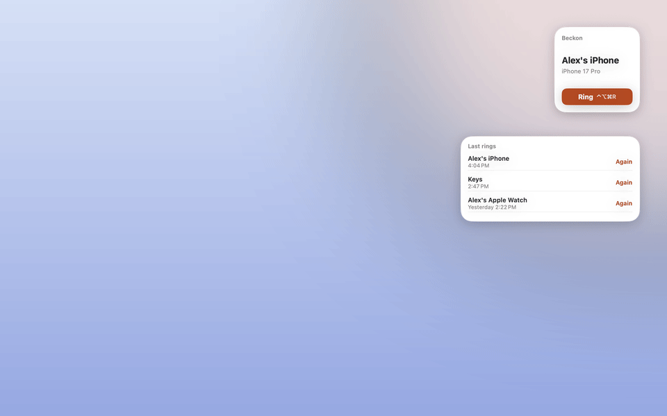
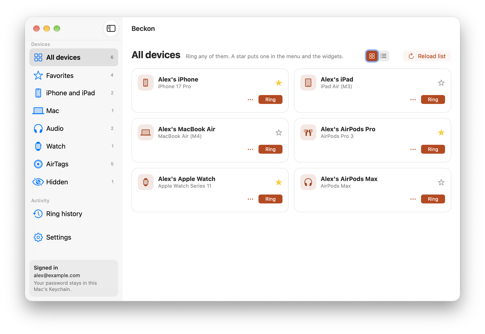
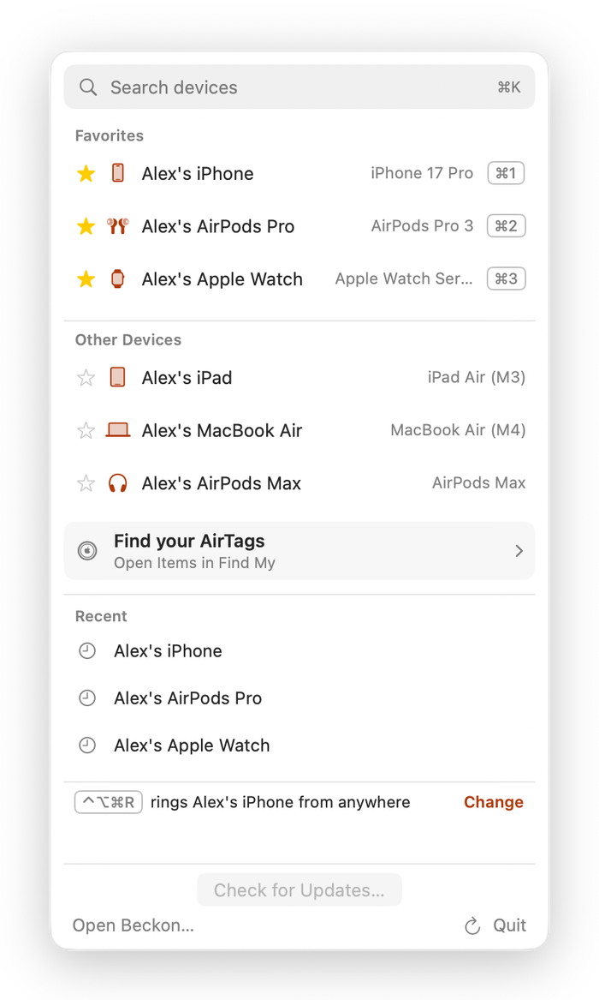
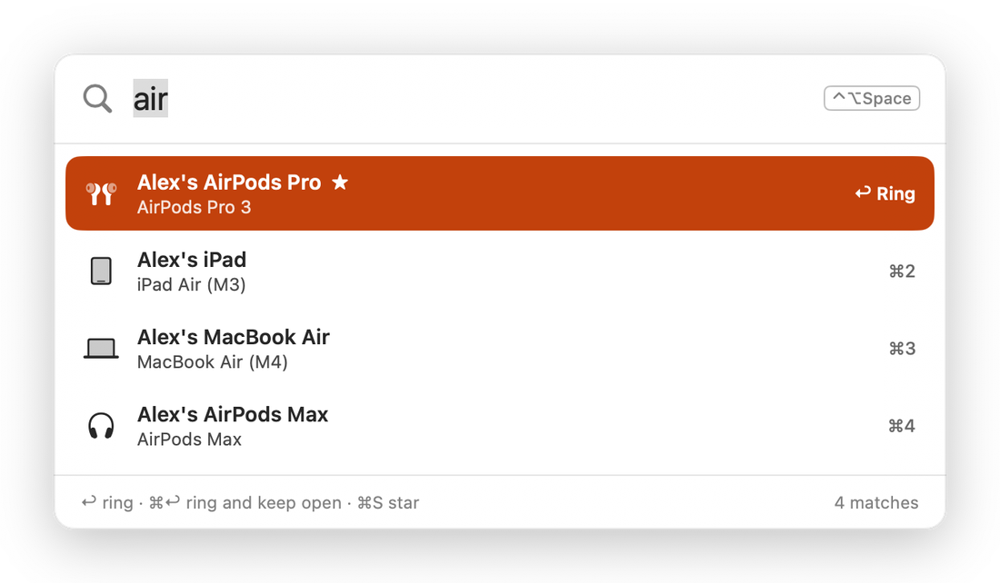
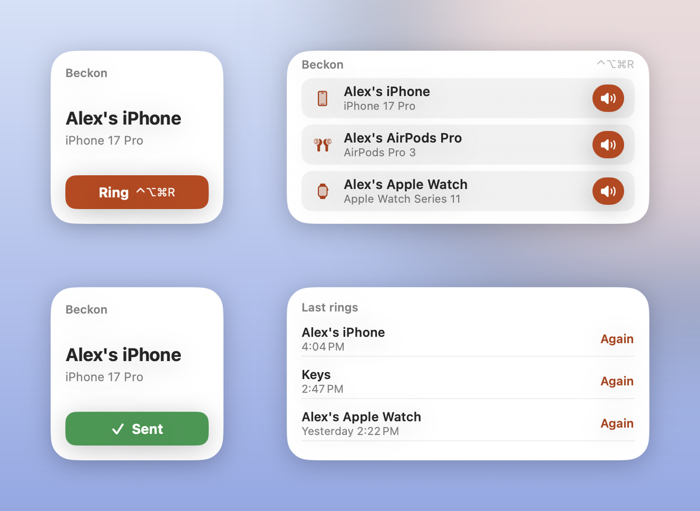

# Beckon

A small macOS (and, later, iOS) app that rings your Apple devices and AirTags
through Find My — one tap, one key or one word to make a misplaced iPhone play a
sound, even on silent. Built 2026-10-15 as "Find My Ring"; redesigned in 0.3.0
and renamed Beckon in 0.4.1 (both 2026-10-16).



**Website:** https://danielyaa5.github.io/beckon/

## Download

**[Download Beckon for Mac](https://github.com/danielyaa5/beckon/releases/latest/download/Beckon.dmg)**
(macOS 14 or later, Apple silicon or Intel; signed and notarized by Apple).

1. Open **Beckon.dmg**. Drag **Beckon** onto **Applications** in the installer window, then open Beckon from Applications. When Beckon opens, it offers to move the downloaded DMG to Trash and ejects the installer disk. Closing the Finder window alone does not eject it.
2. Click the Beckon icon in the menu bar and sign in with your Apple Account
   email and password. Apple checks the password before Beckon saves it, in
   your Mac's Keychain.
3. Star the devices you ring most, and add the **Ring** widget from the
   desktop's Edit Widgets.
4. For AirTags, allow Beckon under System Settings › Privacy & Security ›
   **Accessibility** and **Screen Recording** (only needed for AirTags).

Every release is listed on the
[Releases page](https://github.com/danielyaa5/beckon/releases). Read the
"Unofficial" note below before you sign in.

## First launch (0.6.0)

**Find your AirTags** in the menu bar and **AirTags** in the sidebar open the Items tab directly in Apple's
Find My app. This shortcut doesn't need Accessibility or Screen Recording.

A short walkthrough covers signing in, starring favorites, adding the Ring and
Last rings desktop widgets, keyboard shortcuts, and opening AirTags in Find My. Skip it
at any time or reopen it from Settings > Show walkthrough. Signed-out users get
a compact sign-in card without the device sidebar. The widget extension carries
its own copy of Beckon's icon for the widget gallery.

## Updates (0.5.1)

Beckon uses [Sparkle](https://sparkle-project.org/) to check for signed updates.
Choose **Check for Updates…** in the menu bar or Settings. Automatic checks can
be disabled in Settings; installing an update requires the user's confirmation.
Users on 0.4.4 or earlier must download and install 0.5.1 once.

For a release, run `release/notarize.sh VERSION`, then
`bash release/make-appcast.sh VERSION`. Sparkle 2.10.0's tools must be extracted
into `.tools/sparkle`; the signing key lives in the login Keychain under the
account `beckon`. Only its public key belongs in source control. Review the
resulting `release/build/VERSION/feed/appcast.xml`, upload `Beckon.zip` and
`Beckon.dmg` to the matching `vVERSION` GitHub release, then copy the feed to
`docs/appcast.xml` and publish the site. Do not publish the feed before its ZIP
exists. Increment both version fields in `project.yml` for every release.
The DMG contains the stapled notarized app; the ZIP is the signed update payload.

## Screenshots

| | |
|---|---|
|  |  |
|  |  |

The demo and screenshots show made-up devices. They're drawn by Beckon's own
screenshot mode, so they match the app: `release/screenshots.sh` rebuilds all
of them (see "Screenshots and the website" below).

## What it does (0.4.0: ringing only)

- **Menu bar** (design 3, "keyboard-first"): search on top (⌘K), favorites with
  ⌘1–⌘9, the last rings with "Again", and the global shortcut key.
- **Ring palette**: a Spotlight-style panel on a global shortcut (⌃⌥Space by
  default). Type a few letters, press Return; ⌘↩ rings and keeps it open, ⌘S stars.
- **Ring shortcut key** (⌃⌥⌘R by default) rings your chosen device or first
  favorite from anywhere, with a "Ringing…" confirmation on screen. Both keys
  are changed in Settings (KeyboardShortcuts, no Accessibility needed).
- **App window** (design 5's layout): a sidebar of device groups, device cards
  to ring and star, AirTags, hidden devices, ring history and Settings. Like NordVPN, the app lives only in the menu bar
  with no Dock icon; the window brings a Dock icon while it's open (or always,
  if Settings says so).
- **Widgets**: "Ring" (favorites; small = one device with its shortcut key) and
  "Last rings" (tap to ring again). AirTag buttons in widgets open the app
  through a link, because only the app can drive Find My. After a tap the
  button says "Sending…" while the widget signs in and sends the ring, then
  "Sent" (green) for 10 seconds or "Didn't ring" for 30 (0.4.2; "Sending…"
  since 0.4.4). macOS doesn't redraw a widget while its button's intent is
  running ("Reload not permitted" in chronod's log), and the sign-in plus
  the ring take about 2.5 s, so `RingDeviceIntent.perform()` only marks
  "Sending…" and returns, and the ring finishes in a detached task
  (`WidgetRing`) that marks "Sent" or "Didn't ring". The status
  lives in `widget-status.json` in the App Group, written only by
  `RingDeviceIntent`; the timeline holds a second entry that clears it, so the
  button goes back to "Ring" without the extension running again. Don't add
  `invalidatableContent()` to the button labels: in 0.4.2 it made macOS treat
  clicks on the button as clicks on the widget's background ("Launching from
  widgetURL" in the log), which opened the app instead of ringing (0.4.3).
- **Shortcuts, Spotlight and Siri**: "Ring a Device" (AirTags included), with
  phrases like "Ring Moreno 18 Pro with Beckon".
- **Links**: `beckon://ring/<name>`, `beckon://palette`, `beckon://open`, for
  Raycast, Alfred, Stream Deck or a bookmark. Links from before the rename
  (`findmyring://…`) still work.
- **Hide devices** you never ring (old Macs) from the menu, palette and widgets.
- **Ringing only, by choice (0.4.0)**: the app signs in to Apple to ring, and
  loads your device list (names and models) only at sign-in or when you press
  Reload list. No background or menu-open reloads, and no battery, location,
  place or status is kept or shown; 0.3.x's map widget and battery bars are
  gone. The owner chose this on 2026-10-16 to keep password sign-ins to a
  minimum (hourly reloads meant about 25–40 a day).

Apple has no public API or Shortcuts action for Find My "Play Sound." The one
thing it does allow is signing in to Find My's web endpoints with your Apple
Account **password alone, no 2FA code** (the same thing `icloud.com/find`'s quick
access does). This app does exactly that, in pure Swift, and rings the device.

> Unofficial. It talks to Apple's private Find My web endpoints, so it can break
> whenever Apple changes them, and it is against iCloud's terms to automate the
> service. Fine for your own use / sharing the source; **not** App Store material
> (see `NOTES.md` / the GPT review — guideline 5.2.2 is the blocker).

## How it works

```
widget/menu tap → RingDeviceIntent → FindMyRingKit.FindMyRing
   → password-only SRP-6a sign-in to idmsa.apple.com  (pause 2FA)
   → accountLogin at setup.icloud.com  → findme web service
   → initClient (list devices) / playSound (ring)
```

No session or cookie is ever written to disk (the networking uses an ephemeral
`URLSession`). The app keeps one signed-in client in memory for up to 10
minutes (`App/FindMyService.swift`), so a reload followed by a ring signs in
once; the widget signs in fresh for each tap. What is stored: the password, in
the data protection Keychain in a shared access group, and the Apple Account
email, device list (names and models only), favorites, hidden
devices and settings in `config.json`, plus the last 200 rings in
`history.json`, both in the App Group container so the widgets can read them.
Apple emails you a confirmation after every ring.

## AirTags

AirTags can't be rung through iCloud: Apple's web Find My doesn't support items
at all, and an AirTag has no internet connection — the Find My app plays its
sound over **Bluetooth**. So for AirTags the app drives the Mac's own Find My
app (`App/FindMyAutomator.swift`):

1. open Find My and switch to Items through its View menu (Accessibility);
2. read the window with ScreenCaptureKit + Vision text recognition (Find My
   doesn't expose its window contents to Accessibility on macOS 26+);
3. find the AirTag's row by name and wait until the list stops moving (a click
   on a list that is still gliding after a scroll only stops it), then click it;
4. find the play button: on macOS 27 the clicked row expands in place (place,
   time, then **Directions** and a speaker button labelled just **Play**, which
   can sit below the window's edge, so the list is nudged up if needed); older
   Find My hangs a card with **Play Sound** off the map pin, which is clicked
   only when no expanded row appears. The card counts only when, of the known
   item names above the button, the nearest is this item, so another item's
   row or a map label never qualifies;
5. click Play Sound (its label, then the icon above it if nothing changed) and
   check Find My took it ("Stop Sound", "Playing" or "Pending", or the text
   around the button changed); otherwise report that nothing was rung;
6. hide Find My again and put the pointer back.

Every synthesized click or scroll first checks that Find My is still the front
app and stops otherwise, so switching apps mid-way never sends clicks into
another app. A scan and a ring never run at the same time, and text recognition
runs off the main thread so the menu stays responsive.

**Finding your AirTags** (0.2.5): iCloud's device list has no items, so the
names come from the same window. "Find AirTags in Find My" (also run once by
itself the first time the AirTags section opens empty) scrolls the Items list
from the top, OCR-ing a page at a time, and adds every new name. Each row is a
name over a "place • time" line; a name only counts when that line sits right
under it, so a row cut off at a page edge is read on the next page. The People /
Devices / Items (and, on macOS 27, Me) pills mark the sidebar's edges, in the
41 languages of findmy-cli's table, and when they're missing (the sidebar is
hidden) nothing is read, since the text would be map labels. On macOS 27 item
names start about 58 pt from the window's edge, so the text column begins at
50 pt (findmy-cli's 60 pt cut read nothing there). Verified 2026-10-16 on the
owner's Find My: all 18 items, every name exact. Names are matched exactly, or
one character off for names of five or more characters when no other known item
is as close, because OCR can read the same label differently between captures
(findmy-cli's alias list has "GSXBR Keys" for "GSX8R Keys") while "Bag 1" must
never ring "Bag 2".

Diagnostics are off by default. When a scan reads nothing or a ring fails, the
text Find My showed (item names and places included) can be saved to
`~/Library/Logs/Beckon/` after
`defaults write com.danielyakobian.findmy-ring AirTagDiagnostics -bool YES`.

Limits: the AirTag must be within Bluetooth range of the Mac; the Mac must be
awake and unlocked; it needs **Accessibility** and **Screen Recording** for
Beckon; Find My shows for a moment; and it can break when Apple changes
Find My's layout. It lives in the menu bar only — the sandboxed widget can't
drive another app. A name can still be typed in by hand (as Find My shows
it), and AirTags can be starred into Favorites alongside devices.

The sequence, its constants and the Items-list rules are ported from the `ring`
and `items` commands of [findmy-cli](https://github.com/omarshahine/findmy-cli)
(MIT, Omar Shahine).

## Layout

| Path | What |
|---|---|
| `Sources/FindMyRingKit/` | the shared, platform-agnostic kit: `SRP.swift` (the GSA SRP-6a port, verified against the Python `srp` library), `FindMyRing.swift` (sign-in + Find My calls), `Keychain.swift`, `Crypto.swift`, `Models.swift` |
| `Sources/ringcli/` | a command-line tool to test the kit against a real account |
| `Tests/` | SRP cross-check vectors (Python `srp` → Swift must match) |
| `App/` | the macOS app: `MenuPopover` (menu bar), `RingPalette` + `RingHUD` (palette, on-screen confirmation), `MainWindow` + `MainWindowController` (window, Dock behavior, links), `AppModel`, `FindMyService` (iCloud session), `Hotkeys`, `AppIntents` (Shortcuts/Siri); `FindMyAutomator.swift` rings and finds AirTags through the Find My app; `Screenshots.swift` is the `--screenshots` mode |
| `release/notarize.sh` | Developer ID archive → notarize → staple → zip (signing via Xcode's account) |
| `release/screenshots.sh`, `release/make_media.py` | rebuild the README and website images and demo |
| `docs/` | the GitHub Pages site and the README images |
| `Widget/` | the WidgetKit extension: the Ring and Last rings widgets' timelines; buttons ring through `RingDeviceIntent` in the widget's own process |
| `Shared/` | `SharedStore` (App Group files + shared Keychain, and the screenshot demo data hook), `DeviceInfo` (device kinds, ring targets, status texts), `Theme`, `WidgetViews` (the widgets' views; the app draws them only for screenshots, and `WIDGET_EXTENSION` keeps the ring intent in the extension); compiled into both the app and the widget |
| `project.yml` | XcodeGen spec; `.xcodeproj` is generated, not committed |

`FindMyRingKit` is a SwiftPM package (depends only on `attaswift/BigInt` for the
2048-bit modular exponentiation). The app/widget are an Xcode project generated
from `project.yml`.

## Screenshots and the website

`release/screenshots.sh` builds a throwaway copy of the app (its widget and
Siri metadata stripped, so macOS never mistakes it for the installed one) and
runs `Beckon --screenshots <folder>`. That mode (`App/Screenshots.swift`)
swaps in made-up devices through `SharedStore.demo`, so nothing real is read,
written or rung, and saves each screen with `screencapture -l`: the windows sit
just above the wallpaper, behind everything else, because macOS won't capture
a window placed off screen. The widgets' views live in
`Shared/WidgetViews.swift` so the app can draw them too. Then
`release/make_media.py` (Pillow and ffmpeg) composes the screenshots, the
widgets picture and the demo GIF/MP4 into `docs/`.

`docs/` is also the GitHub Pages site, https://danielyaa5.github.io/beckon/
(`docs/index.html`; `.nojekyll` serves files as they are).

## Build

```bash
# the kit + CLI (and SRP tests)
swift build
swift test

# test the sign-in against a real account (prompts for the password, hidden)
.build/debug/ringcli list <appleID>
.build/debug/ringcli ring <appleID> "<device name>"

# the app + widget
.tools/xcodegen/bin/xcodegen generate
xcodebuild -project FindMyRing.xcodeproj -scheme FindMyRing -configuration Debug \
  -derivedDataPath build/dd -destination 'platform=macOS' \
  -allowProvisioningUpdates -allowProvisioningDeviceRegistration build
open "build/dd/Build/Products/Debug/Beckon.app"
```

XcodeGen is vendored under `.tools/` (portable binary, no Homebrew). Signing uses
the Apple Development cert for team `4JWVY7832S`; the App Group and shared
Keychain group are registered automatically by `-allowProvisioningUpdates`.

## Status (2026-10-16)

- ✅ Pure-Swift password-only Find My sign-in, verified against the real account.
- ✅ SRP port cross-checked against the Python `srp` library (`s2k` + `s2k_fo`).
- ✅ macOS menu-bar app: sign in once, ring any device.
- ✅ macOS widget: interactive buttons for your **starred devices only** (0.2.4;
  up to 3 in the small size, 6 in the medium), which ring from the widget
  process (shared Keychain + App Group), so it works with the app closed. **The widget extension
  must be App-Sandboxed** (`com.apple.security.app-sandbox` + `network.client`
  in `Widget/RingWidget.entitlements`): macOS silently never registers an
  unsandboxed widget — no log line, no gallery entry. The app itself stays
  unsandboxed.
- ✅ Sharing between the app (unsandboxed) and the widget (sandboxed), after the
  widget kept saying "sign in" and the app forgot its sign-in on relaunch:
  - the password must be in the **data protection keychain**
    (`kSecUseDataProtectionKeychain`); in macOS's legacy login keychain
    `kSecAttrAccessGroup` is ignored, so the widget can't read it (0.2.1).
    Every Keychain query must carry that flag: on macOS a query without it
    can hit both keychains, and 0.2.2's "delete the old login-keychain copy"
    deleted the shared password too (fixed in 0.2.3 by dropping all
    login-keychain code);
  - the rest lives in one JSON file in the App Group container, and on macOS
    the App Group must be **team-prefixed** (`4JWVY7832S.com.danielyakobian.findmy-ring`,
    `$(TeamIdentifierPrefix)…` in the entitlements), not `group.…` (0.2.2).
    Since macOS 15 a `group.` container is only open to an app whose
    provisioning profile lists the group; the Developer ID profiles Xcode made
    don't, so macOS denied every read and write, silently (the log shows
    `tccd` refusing `kTCCServiceSystemPolicyAppDataDetailed` with authReason 5).
    A team-prefixed group needs no profile entry. iOS needs `group.` IDs, so
    `SharedStore.appGroup` differs per platform.
  - At launch the app takes the Apple Account from the saved password item if
    the settings file names none, loads the device list if none is saved, and
    calls `WidgetCenter.reloadAllTimelines()` then and whenever sign-in,
    devices or favorites change.
  - Both processes log to subsystem `com.danielyakobian.findmy-ring`:
    `log show --last 10m --predicate 'subsystem == "com.danielyakobian.findmy-ring"'`.
- ✅ Sign-in (0.3.2): the password is checked with Apple before it is saved, so
  a typo never shows as "Signed in"; and when Apple rejects the saved password
  (changed, or the account locked) the app forgets it, so the hourly refresh and
  menu opens never retry a bad password (repeated rejected sign-ins are what get
  an Apple Account locked). The kit (0.3.3) only calls a failure "wrong
  password" on HTTP 401 or Apple's -20101 code; 409, 412, 429 and 5xx get
  their own messages (Apple answers a malformed account name with a 503, which
  0.3.2 still read as a wrong password).
- ✅ App icon (0.3.2): `Icon/AppIcon.icon`, an Icon Composer document (layered
  SVGs + `icon.json`, so macOS draws it in Liquid Glass with light, dark and
  tinted versions). XcodeGen 2.43 doesn't know `.icon`, so `project.yml` maps
  the extension to a single resource file (`options.fileTypes.icon`) and sets
  `ASSETCATALOG_COMPILER_APPICON_NAME: AppIcon`; actool then writes the layers
  to `Assets.car` and an `AppIcon.icns` for older macOS. Preview a change with
  Icon Composer's `ictool <file.icon> --export-image --platform macOS
  --rendition Default --width 512 --height 512 --scale 1 --output-file x.png`.
- ✅ Developer ID signed + notarized via `release/notarize.sh` (0.1.0 to 0.4.4).
- ✅ Favorites: star devices and AirTags to pin them at the top of the menu;
  starred devices are also what the widget shows (AirTags stay menu-only).
- ✅ AirTags, verified on macOS 27 on 2026-10-16: the scan found all 18 of the
  owner's items (0.3.2), and 0.3.4 rang "Organizer" in 13 s from a
  `findmyring://ring/Organizer` link; Find My's own log showed "Play Sound
  button pressed … play sound action succeeded". 0.3.2 and 0.3.3 failed it:
  the row was clicked while the list was still gliding, then the expanded
  row's button reads just "Play".
- ✅ Layout and robustness (0.3.4–0.3.6), checked with window captures
  (`screencapture -x -o -l <CGWindowID>`; find IDs with
  `CGWindowListCopyWindowInfo`):
  - The window keeps its own size: by default `NSHostingController` sized it
    to the content's ideal size (860×1838, taller than the screen), so
    `MainWindowController` sets `sizingOptions = []`, opens at 1060×720,
    autosaves as "FindMyRingWindow" and keeps a restored frame on screen.
  - Desktop widgets are drawn dimmed (vibrant) while another app is in
    front; white labels on the orange fill vanished there, so filled buttons
    and map pins use `filledFace(_:)` (primary on a light tint outside full
    color).
  - The palette ignores its hidden title bar's safe area (no empty band).
  - Offline devices sort after online ones in the menu, palette and window.
  - A device-list reply without `content` is an error, and an empty list never
    replaces a saved one; automatic reloads pause 30 minutes after a server or
    network error; widget AirTag links carry the device id; the small widget
    rings an AirTag hero through `widgetURL`; `history.json` writes are
    coordinated (`NSFileCoordinator`) between the app and the widget.
- ✅ Renamed Beckon (0.4.1): the app's name, menu and window texts, Siri
  phrases, widget titles and links (`beckon://`). Everything that identifies
  the app to macOS stays as it was — bundle id `com.danielyakobian.findmy-ring`,
  the App Group and Keychain group, the log subsystem, the widget kinds — so
  the saved sign-in, favorites, permissions and widgets already on the desktop
  carry over. The repo folder, the Xcode project and scheme (`FindMyRing`) and
  the kit (`FindMyRingKit`) keep the old name.
- ⬜ iOS app + widget target (same kit; a personal build for the owner first).

**Testing a build:** install only the notarized app in `/Applications`. Leftover
copies of `Beckon.app` (or, before 0.4.1, `Find My Ring.app`) (DerivedData, `.xcarchive`, `notarized/`) all claim
the same bundle id and confuse LaunchServices/PlugInKit about which one owns the
widget; `release/notarize.sh` builds into `release/build/<ver>/dd`, so delete
that folder, the archive and `notarized/` after installing (keep the zip).
When the app's path changes (as with the 0.4.1 rename), macOS's widget host
can keep launching the widget from the old path ("Missing executable detected"
in the log; the widget keeps its old look and taps fail): `killall chronod`
fixes it, and launchd starts it again at once.
If a desktop widget then shows only a sliver on screen while screenshots show
it whole, `killall NotificationCenter` makes the desktop redraw it.

There is also a separate, already-running home-network version in
`~/Developer/findmy-sound` (a server on moms-air-m2 that Shortcuts widgets hit);
this project is the standalone, no-server app that replaces it.
